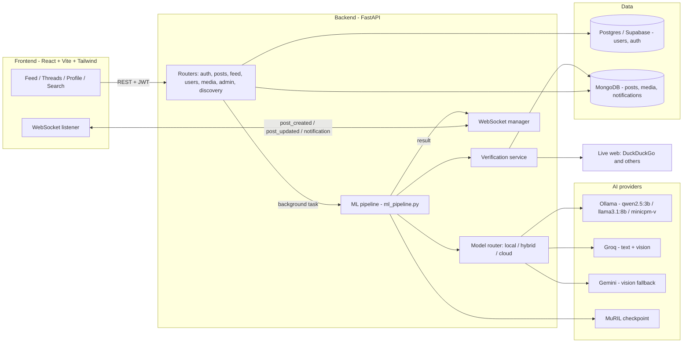
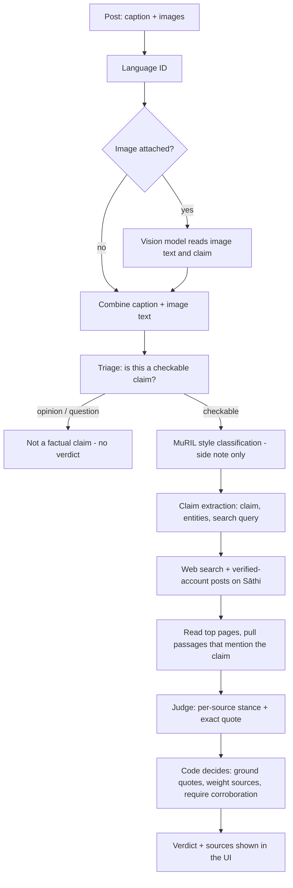

<p align="center">
  
</p>

# Sāthi — Multimodal, Multilingual Fake-News Checking on a Social Feed

> **Status: work in progress.** Sāthi is a college major-project prototype under active development. The core pipeline works end to end, but several parts are still being built, tuned, or replaced (see [Project Status](#project-status) and [Roadmap](#roadmap)). It is a demonstration system, not a production service.

Sāthi (साथी, "companion") is a Twitter-like social app in which news posts are fact-checked as they are published. A post's text and attached images go through an AI pipeline that extracts the claim, searches the live web (and the platform's own verified news accounts) for evidence, and returns a verdict — **with the sources and the exact quotes it relied on**. The pipeline runs on local models through Ollama when a GPU is available, and falls back to Groq and Gemini in the cloud when it is not.

## Overview

Most fake-news classifiers read a post and output "real" or "fake" from writing style alone. That is not fact-checking: a well-written lie looks real, and a clumsy truth looks fake. Sāthi separates the two ideas:

- **Model classification** — a MuRIL transformer fine-tuned for Indian languages reads *how a post is written*. It is shown as a side note only and **never decides the headline verdict**.
- **Factual verification** — the headline result comes from **evidence**: live search results, pages actually read, and posts from verified news accounts on the platform, judged source by source and combined by plain, explainable code rather than by a model's opinion.

The project targets multilingual (English plus Indic-language) posts, accepts images (for example a screenshot of a "breaking news" headline), and is designed around a real constraint: it should run on a single 6 GB laptop GPU, one model at a time.

## Key Features

- **Evidence-based verdicts** — Supported / Contradicted / Mixed / Insufficient / Unavailable, each with the sources checked and the quoted passage behind every citation
- **Image-aware checking** — text and claims inside attached images are read by a vision model and merged with the caption before the claim is extracted and searched
- **Local-first with cloud fallback** — `local`, `hybrid` or `cloud` modes; Ollama models first, then Groq (text and vision), then Gemini (vision)
- **Explainable decision logic** — a small model labels each source; the verdict itself is computed by deterministic code (weights, quote grounding, corroboration rules)
- **Platform news as evidence** — recent posts from verified news and government accounts on Sāthi count as the strongest source
- **Full social-app basics** — sign-up/sign-in, posts, threaded replies, likes, reposts, follows, notifications, multi-image/GIF/video attachments, profiles with avatar and banner, search, and live trending topics
- **Verification tiers** — gold (verified person), red (news), green (government), black/white (company), and admin; news and government accounts skip the pipeline
- **Admin tools** — grant or revoke verification, delete any post, **re-run the fact-check on any post**, clean up orphaned media
- **Realtime updates** — verdicts, new posts, deletions and notifications are pushed to the UI over WebSockets
- **Deployable demo** — Render blueprints for the API and the static frontend, with MongoDB Atlas and Supabase Postgres

## Architecture



### Major components

| Part | Role |
| --- | --- |
| `app/routers/` | REST endpoints: auth, posts and threads, feed, users and follows, media upload, notifications, discovery (search + trending), admin, WebSocket |
| `app/services/ml_pipeline.py` | Orchestrates the whole analysis of a post and assembles the response |
| `app/services/ai/router.py` | The model-routing layer: picks Ollama, Groq or Gemini per stage by `AI_MODE`, with fallback |
| `app/services/verification_service.py` | Search → platform news → read pages → judge → decide |
| `app/services/ai/evidence_scoring.py` | Deterministic verdict logic: quote grounding, source weights, corroboration |
| `app/services/ai/search_tool.py`, `page_reader.py` | Web search (curated engines, caching, throttling, retry ladder) and safe page reading |
| `app/services/ai/source_policy.py`, `platform_news.py` | Trusted-outlet policy and verified-account posts as evidence |
| `app/services/text_classifier.py` | MuRIL text classifier, with a heuristic fallback when no checkpoint is present |
| `app/db/` | Async SQLAlchemy (Postgres) and Motor (MongoDB) setup |
| `src/` (frontend) | React app: pages, post cards, analysis panel, verification badges, API client with WebSocket events |

### Pipeline: what happens when someone posts news

A post is fact-checked only if the author ticks **News** or the text carries news markers (such as `#breaking`). Replies are never checked, and verified news/government accounts are exempt.



1. **Language identification** of the post.
2. **Image understanding** (if images are attached) — MiniCPM-V locally, otherwise Groq vision, then Gemini. The image text is merged with the caption so the claim and the search query reflect what the image actually says.
3. **Triage** — opinions and questions are not treated as factual claims.
4. **MuRIL classification** — a style-based signal shown separately and explicitly labelled as unable to judge truth.
5. **Claim extraction** — Qwen2.5-3B locally (or Groq) produces the claim, key entities and a search query.
6. **Evidence retrieval** — live search (freshest news first), plus recent posts from verified news/government accounts on the platform.
7. **Page reading** — the top results are fetched and the passages mentioning the claim's names are extracted, rather than judging from one-line snippets.
8. **Judging** — the model labels each source "supports" or "contradicts" and must quote the exact words that show it.
9. **Decision (plain code)** — see below.

### How the verdict is decided

The model never decides the verdict. It only labels individual sources; `evidence_scoring.py` does the rest:

- **Grounding** — a citation whose quote does not actually appear in the source text is discarded as invented.
- **Weighting** — platform news/government post = **3**, trusted outlet / official / fact-checker = **2**, any other site = **1**.
- **Corroboration** — a side only counts if it has at least one weight-2+ source or two independent websites; one random page cannot stamp a claim true *or* false.
- **Silence is not contradiction** — a source that merely does not mention the claim is never cited.
- **Result** — nothing established → *insufficient*; one side established → *supported* / *contradicted*; both established → the side with at least double the weight wins, otherwise *mixed*.

When evidence is insufficient the UI says so honestly ("Not enough evidence to prove this claim. It may be fake — treat it with caution") and lists exactly which sources were checked.

## AI / Model Architecture

| Role | Local (Ollama) | Cloud fallback |
| --- | --- | --- |
| Claim extraction, entities, search query | `qwen2.5:3b` | Groq `openai/gpt-oss-20b` |
| Evidence judging | `qwen2.5:3b` (second opinion from `llama3.1:8b` on unclear cases) | Groq `openai/gpt-oss-20b` |
| Image understanding / OCR | `minicpm-v` | Groq vision (`GROQ_VISION_MODEL`), then Gemini |
| Writing-style classifier | MuRIL checkpoint (fine-tuned for fake-news detection) | Built-in heuristic fallback |

**Routing modes** (`AI_MODE`): `local` (Ollama only), `hybrid` (default — Ollama first, cloud when a local model is unavailable), `cloud` (skip Ollama).

**Designed for a 6 GB GPU.** Only one heavy model is resident at a time: the router explicitly unloads the current Ollama model before switching to another, and the vision model runs with `keep_alive=0` so it is released straight after use. The vision call follows the approach used in the author's earlier project NovaAI — a plain-text prompt with no grammar-constrained JSON — which avoided a Windows/CUDA crash seen with the heavier call path.

**Time-aware.** Every model prompt includes the current date and time, so "latest" and "recent" are interpreted correctly.

> The MuRIL model is trained in a separate project and is not retrained here. Because it reads style rather than facts, it is intentionally excluded from the headline verdict.

## Tech Stack

| Layer | Technology |
| --- | --- |
| Frontend | React 19, Vite, Tailwind CSS v4, React Router, lucide-react |
| Backend | Python, FastAPI, Uvicorn |
| Auth | JWT, bcrypt-hashed passwords |
| Users database | PostgreSQL (Supabase), async SQLAlchemy + asyncpg |
| Content database | MongoDB (Atlas), Motor — posts, media bytes, notifications, view tracking |
| Local models | Ollama — Qwen2.5-3B, Llama-3.1-8B, MiniCPM-V |
| Cloud models | Groq (text + vision), Gemini (vision) |
| Text classifier | MuRIL (Hugging Face Transformers, PyTorch) |
| Search and retrieval | `ddgs` (multiple engines), page fetching with SSRF protection |
| Language ID | `langdetect` |
| Realtime | WebSockets |
| GIF search | Klipy API |
| Deployment | Render (API + static site), MongoDB Atlas, Supabase |

## Repository Structure

Sāthi lives in two repositories:

- **Backend:** [`MajorProject-Backend`](https://github.com/yatharth-singh50/MajorProject-Backend)
- **Frontend:** [`MajorProject-Code`](https://github.com/yatharth-singh50/MajorProject-Code)

```text
MajorProject-Backend/
├── app/
│   ├── main.py                    # app setup, CORS, health check, startup
│   ├── core/                      # config, hashing, JWT/security
│   ├── db/                        # postgres.py, mongodb.py
│   ├── models/                    # SQL models, Pydantic schemas
│   ├── crud/                      # posts, users, follows, media, notifications
│   ├── routers/                   # auth, posts, feed, users, media, notifications,
│   │                              # discovery, admin, analyze, ws
│   ├── services/
│   │   ├── ml_pipeline.py         # end-to-end analysis of a post
│   │   ├── verification_service.py
│   │   ├── text_classifier.py     # MuRIL + heuristic fallback
│   │   ├── language_id.py, news_detect.py, gif_search.py
│   │   └── ai/                    # router, ollama/groq/gemini clients, search_tool,
│   │                              # page_reader, evidence_scoring, source_policy,
│   │                              # platform_news, time_context
│   ├── utils/media.py
│   └── websockets/manager.py
├── tests/
├── requirements.txt, requirements-deploy.txt
├── render.yaml, docker-compose.yml
└── .env.example

MajorProject-Code/
├── public/Sathi_Logo.png
├── src/
│   ├── pages/                     # Home, PostDetail, Profile, Search, Notifications,
│   │                              # Settings, SignIn, SignUp
│   ├── components/
│   │   ├── post/                  # PostCard, ComposeBox, AnalysisPanel, MediaGrid,
│   │   │                          # VerificationBadge, OverallVerdictBadge
│   │   ├── common/                # Logo, VerifiedBadge, Avatar, pickers, modals
│   │   └── layout/                # Sidebar, RightRail, MobileNav, AppShell
│   ├── context/                   # auth, theme, toasts
│   ├── hooks/                     # post lists, view tracking
│   └── services/api.js            # REST client + WebSocket events
└── render.yaml
```

## Setup

### Prerequisites

- Python 3.12, Node.js 22
- MongoDB (local or Atlas) and PostgreSQL (local or Supabase)
- *Optional, for local AI:* [Ollama](https://ollama.com) and a GPU
- *Optional, for cloud AI:* a Groq API key and/or a Gemini API key

### 1) Backend

```bash
git clone https://github.com/yatharth-singh50/MajorProject-Backend
cd MajorProject-Backend
python -m venv .venv && source .venv/bin/activate      # Windows: .venv\Scripts\activate
pip install -r requirements.txt                         # install CUDA PyTorch separately for MuRIL
cp .env.example .env                                    # then fill in the values (see Configuration)
uvicorn app.main:app --reload
```

The API is served at `http://localhost:8000` (interactive docs at `/docs`, status at `/health`). Database tables and indexes are created on startup.

### 2) Local models (optional)

```bash
ollama pull qwen2.5:3b
ollama pull llama3.1:8b
ollama pull minicpm-v
```

Without Ollama, set `AI_MODE=cloud` (or leave `hybrid` — it will fall back automatically) and provide `GROQ_API_KEY` / `GEMINI_API_KEY`.

### 3) Frontend

```bash
git clone https://github.com/yatharth-singh50/MajorProject-Code
cd MajorProject-Code
echo "VITE_API_BASE_URL=http://localhost:8000" > .env
npm install
npm run dev
```

Open the printed local URL, register an account, and post. To fact-check a post, tick **News** or include `#breaking`.

### 4) MuRIL checkpoint (optional)

Place the fine-tuned checkpoint at the path given by `TEXT_MODEL_PATH` (default `./models/muril_combined`). If it is missing, a lightweight heuristic classifier is used instead; the headline verdict is unaffected.

## Configuration

Secrets live in `.env` (never committed). The settings that matter most:

| Variable | Purpose |
| --- | --- |
| `MONGODB_URI`, `MONGODB_DB_NAME` | Posts, media, notifications |
| `POSTGRES_URI` | Users — `postgresql+asyncpg://…` (Supabase *session pooler* URL when deployed) |
| `JWT_SECRET_KEY` | Token signing; the app refuses to start in production with the default |
| `CORS_ORIGINS` | Allowed frontend origin(s) |
| `AI_MODE` | `local`, `hybrid` (default) or `cloud` |
| `OLLAMA_*` | Base URL and model names for the claim, deep and vision models |
| `GROQ_API_KEY`, `GROQ_MODEL`, `GROQ_VISION_MODEL` | Cloud reasoning and vision fallback |
| `GEMINI_API_KEY`, `GEMINI_MODEL` | Second vision fallback |
| `KLIPY_API_KEY` | GIF search (optional) |
| `ADMIN_USERNAMES` | Comma-separated usernames that get admin rights |
| `BYPASS_PIPELINE_TIERS` | Verification tiers whose posts skip fact-checking (default `news,government`) |
| `ENABLE_REALTIME_VERIFICATION` | Turn live evidence checking on or off |
| `TRENDING_WINDOW_HOURS` | Look-back window for trending topics |

Frontend: `VITE_API_BASE_URL` (baked in at build time).

## Deployment

Both services have Render blueprints (`render.yaml`): the API as a Python web service and the frontend as a static site, backed by MongoDB Atlas and Supabase. A `requirements-deploy.txt` omits PyTorch to fit the free tier, so on Render the app runs with the heuristic classifier and **every AI step uses the Groq/Gemini fallback** — which is precisely the path the deployed demo exercises. Free-tier services sleep after inactivity and take about a minute to wake.

## Using the Demo

1. Register two or more accounts and post normally — ordinary posts are not fact-checked, by design.
2. Tick **News** (or add `#breaking`) on a post → it shows "Analyzing…" and updates live with a verdict, the sources checked and their quotes.
3. Try an image post: caption "Breaking News!" with a screenshot of a fabricated headline — the image text is read, merged into the claim, and searched.
4. Sign in as an admin: open a profile and assign a verification tier; use the refresh icon on any post to **re-run the fact-check**.
5. Check Trending (hashtags and recurring topics), follow people, and watch Notifications for likes, reposts, replies and verdicts.

## Engineering Challenges / Design Decisions

### 1) A style classifier is not a fact-checker
**Problem:** The trained MuRIL model reported "real, 93%" for a fabricated claim, because it reads writing style only.
**Approach:** Classification and verification are separate signals; the headline comes only from evidence, and the model's output is labelled as a style note.
**Why it matters:** Prevents a confident-but-meaningless score from being mistaken for a fact-check.

### 2) Letting a small model judge sources, but not the verdict
**Problem:** A 3B local model asked for a verdict mislabelled a true story as "likely fake" when search results were merely off-topic.
**Approach:** The model only labels each source and must quote its evidence; code verifies the quotes exist, weights sources, requires corroboration, and computes the verdict.
**Why it matters:** The outcome is explainable and cannot be talked into a conclusion by one noisy page.

### 3) Images are part of the claim
**Problem:** A post captioned only "Breaking News!" with a fake headline screenshot was searched using the caption alone.
**Approach:** The vision stage now runs first, and its text is merged into the caption before triage, claim extraction and search.
**Why it matters:** The models actually collaborate instead of working on separate halves of the post.

### 4) One GPU, several models
**Problem:** A 6 GB GPU cannot hold a text model, a deeper model and a vision model together.
**Approach:** Sequential use with explicit eviction before switching models; the vision model is released immediately after each call.
**Why it matters:** Keeps the local path usable on a laptop.

### 5) Unreliable web search
**Problem:** Search engines throttle repeated automated queries and sometimes return junk.
**Approach:** Curated engine lists, caching, request pacing and concurrency limits, a retry ladder that rewrites queries, relevance filtering, and honest reporting of what was searched.
**Why it matters:** Fewer false "unverified" results, and the UI shows exactly what was checked.

### 6) Graceful degradation across providers
**Problem:** The demo must work with or without a GPU.
**Approach:** A routing layer with `local` / `hybrid` / `cloud` modes; each stage returns a result that records which provider answered or why none could, and the pipeline falls through Ollama → Groq → Gemini.
**Why it matters:** The same code runs on the developer laptop and on a GPU-less cloud host.

### 7) Safe retrieval and hosting
**Approach:** Page fetching is guarded against requests to internal addresses; database URIs are redacted from logs; API keys travel in headers, not URLs; production refuses the default JWT secret.

## Project Status

**Sāthi is a work in progress.** The following works today: accounts and the social features, the evidence-based pipeline with local and cloud models, image-aware checking, admin tools, realtime updates, and a Render deployment for team testing.

Known limitations, stated plainly:

- Verdict quality depends on what the live web returns and on a small local model reading it; results can still be "Insufficient" for real news that is thinly covered.
- Web search from cloud hosts is rate-limited more than from a home connection, so the deployed demo is more likely to answer "Unverified".
- The MuRIL checkpoint is not used in the free-tier deployment (no GPU, limited RAM).
- Only still images are read by the models; GIFs and videos are displayed but not analysed.
- There is no password-reset or email verification yet.
- No formal accuracy evaluation of the end-to-end pipeline has been done yet.

## Roadmap

- Evaluate the pipeline on a labelled set of real and fabricated claims (English and Indic languages) and report results
- MuRIL + ViT multimodal fusion model (the image encoder is in the codebase but not yet used)
- Account recovery and email verification
- Better multilingual claim extraction and search-query generation
- A moderation / appeal flow for disputed verdicts

## Privacy & Security Notes

- Passwords are stored only as bcrypt hashes; sessions use signed JWTs.
- Secrets are supplied through environment variables and are not committed.
- In `local` mode, post text and images are processed on the machine running the backend. In `hybrid`/`cloud` mode, claim text, search snippets and images may be sent to Groq and Gemini.
- Search queries and page fetches go to the public web.
- This is a prototype: there is no rate limiting, content moderation, or formal security audit.

## Disclaimer

Sāthi's verdicts are automated and can be wrong. They are meant to help a reader judge a claim by showing the evidence, not to replace it. Do not treat a verdict as a final determination of truth.

## Acknowledgements

The local vision-model integration follows the approach from the author's earlier project, NovaAI. MuRIL is by Google Research; models are served through Ollama, Groq and Google Gemini.

## Authors & Collaborators

Yatharth Singh, Vinayak Sunil Rodd, Vishwajit Anand, Vaibhav Kumar
